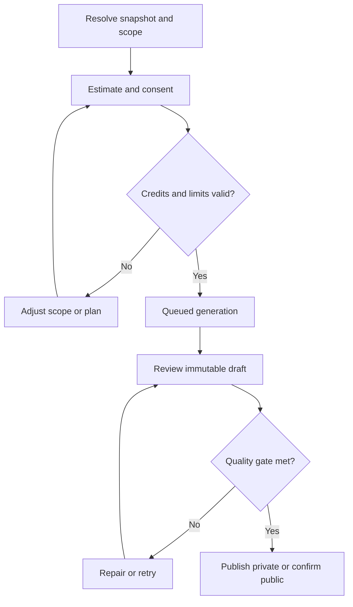

# User flows

## First run and private build

1. Sign in through Google/GitHub. API validates callback and creates an opaque session, then redirects to a safe app path.
2. Create a workspace. Explain that its members can see all workspace projects.
3. Connect GitHub repository access through the separate GitHub App installation flow. A Google-login user can link a GitHub identity for repository authority without changing their login provider.
4. Select authorized repository and branch; API resolves exact commit and acquires snapshot. Safe scan returns counts and exclusions.
5. Choose scope/preset/cap. Estimate includes SHA, config digest and expiry; disclose what source is sent to which model processor.
6. User starts generation. API reserves capacity and writes build/outbox transaction; UI enters status screen.
7. Worker completes stages and produces immutable validated artifacts. User reviews coverage, citations and remaining warnings.
8. Admin publishes to workspace members. Public is a separate deliberate choice. Reader opens files, follows definitions, checks citations and downloads only if authorized.

## Build failure, cancellation and recovery

Provider 429/5xx gets bounded retry and visible waiting state. Worker failure expires its lease; scheduler redelivers recoverable work. Completed artifacts remain checkpoints. A failed checker is unchecked, not supported. Cancel sets a durable flag; workers stop before another external request and settle already consumed usage. Retrying is a new attempt linked to the failed build, using the same SHA/config and tenant-local compatible checkpoints. A changed config/ref requires a new estimate.

## Update and publication

The current published build remains immutable while a new build runs. Latest observed upstream SHA may differ from published SHA, shown as “update available”; API outage means freshness unknown. Build review → publish with expected current publication version → transactional pointer swap → audit. Rollback chooses an older retained ready build, revalidates current access and visibility, then swaps pointer. A concurrent publish returns conflict and asks the user to inspect current state. Deleting the current build requires unpublish or replacement first.

## Purchases and membership

Owner chooses plan → server creates checkout → provider collects payment → signed webhook recorded once → reconciliation updates entitlements → UI refetches. Browser redirect alone grants nothing. Cancellation schedules downgrade at paid period end. Outstanding reservations count against capacity throughout the transition.

Admin invites by email → recipient signs in → server requires matching verified address and unexpired one-time invite → membership committed. Invite link alone grants no repository data. Removing a member invalidates authorization on subsequent API/stream requests and clears their viewer state. Ownership transfer requires current owner reauthentication and keeps at least one owner.

## Export and deletion

Admin requests export → access and entitlement checked → background package generation → short-lived authenticated download endpoint. Warn that source and explanations are included, and downloaded copies cannot be recalled. Project deletion immediately disables serving, cancels jobs, removes publication pointer and schedules object/cache cleanup. Account deletion prompts ownership transfer or explicit deletion of solely owned workspaces. Retained accounting records are minimized and separated from source content.

## Offline and revoked connection

Network loss allows only already visible in-memory content; no pending action is replayed on reconnect. Reconnect refetches state before enabling controls. Installation revocation marks connection blocked and affected private publication suspended; UI guides admin to reconnect/review. The service's workspace authorization does not silently treat a stale GitHub installation as continuing repository authority.
