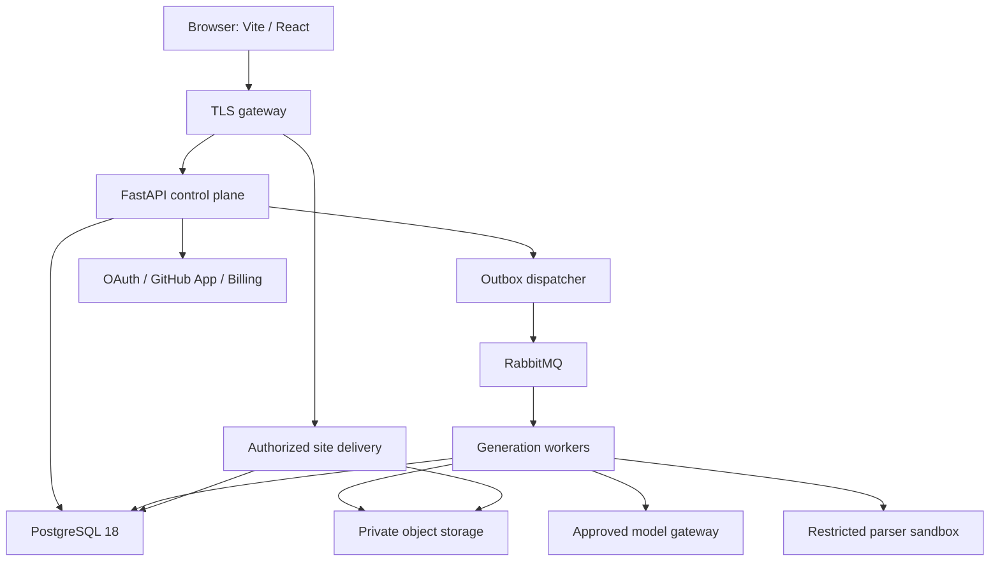

# System architecture

## Architecture and service boundaries

Use a modular monolith for product rules, independently scaled workers for generation and restricted subprocesses for parsing/indexing. Avoid early microservices. Browser calls same-origin `/api/v1`; nginx serves Vite assets and proxies API/SSE. PostgreSQL owns all durable product/job/usage state. RabbitMQ carries task notifications, never the sole record of a build.

Modules: identity; workspaces/memberships; repository connections; projects/configurations; snapshots/scans; estimates; builds/tasks; generation engine; publication/delivery; artifacts/exports; quotas/ledger; billing; audit/admin. Modules exchange typed service commands inside API/worker, not ad hoc HTTP loops. API never runs a build in FastAPI BackgroundTasks.

## Runtime choices

Python 3.13, FastAPI/Pydantic 2, SQLAlchemy 2.x async, psycopg 3 and Alembic. One AsyncSession per request/task; never share between concurrent coroutines. Transaction-scoped tenant setting and short transactions. No database transaction remains open while waiting on GitHub, model HTTP or object uploads. Use httpx with explicit connect/read/write/pool timeouts; boto3 in bounded thread pool for S3 adapter. Authlib or an equivalently reviewed server-side OAuth/OIDC client; actual selected release is locked after compatibility tests.

aio-pika explicit consumers instead of Celery for MVP: lease, retry and budget behavior are domain rules visible in PostgreSQL. Worker command separates supervisor from bounded subprocess tasks. Prefetch 1 for expensive tasks, independent per-stage concurrency. PostgreSQL advisory locks/row locks handle initial coordination; add a distributed rate-limit cache only after demonstrated need.

## Outbox, delivery and leases

Create build, stage task, reservation and outbox row in one SQL transaction. Dispatcher selects due unpublished rows `FOR UPDATE SKIP LOCKED`, publishes persistent messages to durable exchange/queues with mandatory routing and confirms, then records dispatch. Publish/mark crash may duplicate: consumer deduplicates task ID and generation, and claims SQL lease atomically. Acknowledgment follows durable task result or durable retry scheduling. Unexpected worker death causes redelivery/lease expiry; a reconciler recreates notifications for runnable SQL tasks with no live lease. Messages contain task/build/workspace IDs, schema version and trace ID, never tokens or code.

Lease default 120s, heartbeat every 20s, bounded HTTP call 300 s (15 s to connect). Long stages split into per-file/page work units. A worker that loses its fencing generation may no longer commit artifacts, settle reservations, or advance stage state. Unique task key `(build_id, stage, variant, work_key)` and compare-and-set status eliminate duplicate finalization. Call attempt records distinguish started/completed/unknown external spend. Exactly-once model execution is not promised; provider request idempotency/status lookup is used where supported. Unknown billing outcomes require reconciliation and cannot silently receive another unrestricted budget reservation.

Transient errors: capped retries at 5/30/120 seconds plus jitter, max three retries; persist `next_attempt_at` in SQL. Scheduler releases due tasks through outbox. Permanent input/schema/auth errors fail immediately; invalid model response gets one repair call inside budget. Poison tasks go to dead-letter queue and SQL failed state. No infinite nack/requeue loop. RabbitMQ 4 quorum queues apply a default delivery limit of 20 and drop over-limit messages unless a dead-letter exchange is configured, so declare the DLX by policy for every work queue; retries are scheduled from SQL, never by broker requeue.

The dispatcher, scheduler and lease reconciler scan work across all workspaces, which FORCE RLS denies to the runtime role. They connect as `app_system`, a role limited to the outbox and task scheduling columns (see document 05, "Tenant context resolution and database roles"). Task workers process one task inside its workspace context as `app_runtime`.

## Snapshot and artifact contracts

Resolve ref before acquisition and store exact commit SHA, provider repository ID and default branch observation time. Download only through approved GitHub API endpoints using short-lived installation credentials. Reject arbitrary remote URLs/SSH/local paths; do not fetch submodules or LFS targets. Expanded snapshot is immutable and hashed. Parse tools run with no credentials/network and read-only source; no hooks, builds or dependency installation.

Object namespace `workspaces/{wid}/projects/{pid}/builds/{bid}/...`; metadata rows include checksum, byte size, content type, version and retention. Storage is private, list access disabled. Artifact manifest is uploaded last after all checksums validate; ready state commits after manifest existence check. Publication is a database pointer to a ready immutable build. Missing object or invalid manifest yields safe 503, never fallback to another tenant/build.

Private viewer serves structured JSON/text through FastAPI authorization on every endpoint. Do not serve tenant-produced HTML under the authentication origin. Public static artifacts, if hosted as HTML, require separate cookie-free site origin and sanitized generated assets. MVP hosted viewer uses the product-controlled React renderer; export ZIP can include static HTML. Public assets route through revocable authorization checks with `no-store` initially, avoiding uncontrolled CDN copies.

## Scaling and operations

API replicas are stateless except SQL session data. Split acquisition, model, rendering/export worker pools when resource contention appears; cap per-workspace concurrency to prevent starvation. Tenant-aware scheduler round-robins eligible workspaces; large builds cannot occupy all workers. Object storage absorbs large source/output payloads; PostgreSQL stores metadata and bounded searchable prose. Initial search uses PostgreSQL tsvector/trigram with identifier normalization plus stored reference edges, no vector DB needed.

Dev: one PostgreSQL, one RabbitMQ, local S3-compatible store and fake providers. Staging: separate OAuth apps, secrets, data and storage. Production: managed PG with PITR, 3-node RabbitMQ quorum queues if HA required, managed object storage, private service network, TLS termination and outbound firewall. Single-node Compose is a development/small pilot setup, not HA.

SQL connection budget: start API pool 5 + overflow 5 per replica, worker pool 3 per process; sum all pools plus migration/operations headroom below PostgreSQL max connections. Measure before raising workers. Migrations run once as a release job using separate DDL credentials; runtime role cannot alter schema. Expand/contract migrations precede destructive cleanup. Roll back app only while schema backward-compatible; otherwise restore/forward-fix under the runbook.
